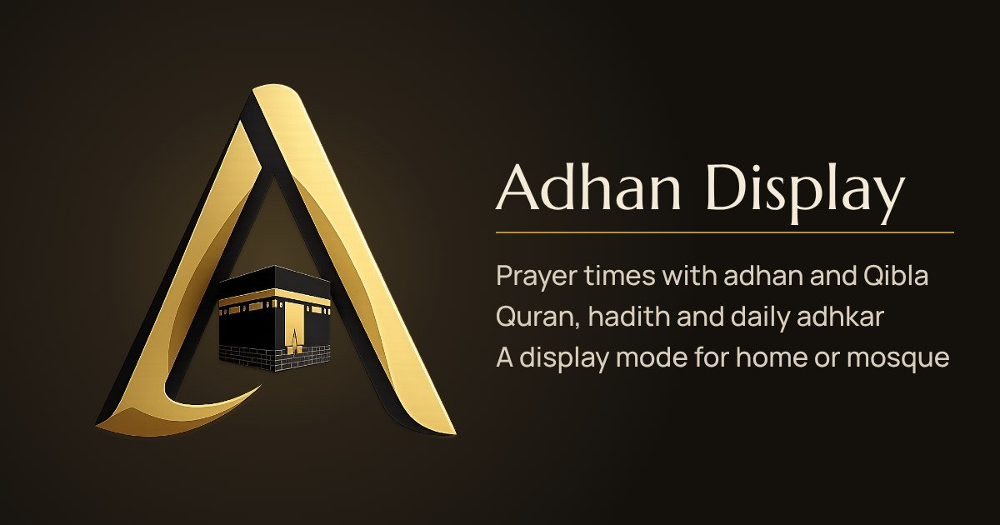

# Adhan Display



**Adhan Display** is a free prayer time dashboard for your phone, computer, tablet or a screen on the wall. It shows accurate prayer times with the adhan, a Qibla compass, the Quran with translation and recitation, hadith, a prayer tracker and Islamic tools. It runs entirely in the browser and keeps your data on your own device.

Live: [adhandisplay.com](https://adhandisplay.com)

## Features

**Prayer**
- Prayer times for your location with 23 calculation methods, Hanafi or standard Asr, a high latitude rule and per-prayer adjustments
- Countdown to the next prayer, a timeline of the day and the night times (middle of the night, last third)
- Adhan at prayer time with a choice of recitations, per prayer on or off, plus an optional reminder before the adhan and a tahajjud reminder
- Monthly timetable with print layout
- Qibla compass with live device heading
- Correct times and countdowns when the chosen city is in another time zone

**Display mode**
- Full-screen clock for a tablet, TV or mosque screen
- Keeps the screen awake, dims at night and highlights the next prayer

**Quran**
- All surahs and juz in Uthmani script with translations in dozens of languages
- Ayah-by-ayah recitation with a player that keeps playing while you browse
- Bookmarks, continue reading, search in translation or Arabic and tafsir Ibn Kathir

**Hadith**
- Sahih al-Bukhari, Sahih Muslim and eight other collections
- Browse, search, jump to a number, save and share

**Islamic tools**
- Morning and evening adhkar with counters
- Tasbih counter with targets
- 99 Names of Allah
- Ramadan countdown with suhoor and iftar times
- Islamic calendar with upcoming occasions and the white days

**Tracker**
- Mark your five daily prayers, fasting and Surah Al-Kahf
- After ticking off a prayer, optionally mark it as prayed late (the default is on time); the statistics show how many prayers were on time
- Streaks, completion rates and a four-week overview
- Make-up (qada) counter and an optional exemption mode

**Languages**
- The interface is available in 11 languages: English, 中文, हिन्दी, Español, Français, العربية (right-to-left), বাংলা, Português, Русский, اردو (right-to-left) and Nederlands
- The language follows the browser on the first visit and can be changed in Settings, Appearance
- The Quran translation follows the chosen language; hadith texts, tafsir and the meanings of adhkar stay in English

## Install as an app

Adhan Display is a Progressive Web App.

- **Android and desktop Chrome or Edge:** open the menu and choose *Install app*, or use the button in Settings, About.
- **iPhone and iPad (Safari):** tap *Share*, then *Add to Home Screen*.

## Project structure

```
index.html            Page shell, SEO and theme/language boot script
sw.js                 Service worker (offline support)
manifest.json         Web app manifest
css/app.css           All styles (dark theme by default, light theme, print)
js/app.js             App shell, router and the one-second ticker
js/app-info.js        Version and install prompt
js/core/              Storage, time zones and Hijri dates, icons, UI helpers
js/services/          Prayer times, location, adhan alerts, tracker, Quran and API access
js/pages/             Home, Prayer, Quran, Hadith, Islamic, Settings and Display mode
js/data/content.js    Daily hadith, du'as, adhkar and other static content
js/i18n/              Interface translations, one file per language (en.js is the base)
fonts/                Self-hosted Manrope (Latin and Cyrillic), Marcellus and Amiri Quran (SIL Open Font License)
images/icons/         App icons
audio/                Adhan recordings and the reminder chime
nginx.conf            Optional config for self-hosting with nginx
```

There is no build step. The site is plain HTML, CSS and JavaScript modules.

## Run locally

```bash
git clone https://github.com/iamkhomani/Adhan-Display.git
cd Adhan-Display
python3 -m http.server 8080
```

Then open <http://localhost:8080>. A local web server is needed because browsers do not load JavaScript modules from `file://`.

## Translations

Every text in the interface comes from `js/i18n/<code>.js`. English (`en.js`) is the base; missing keys fall back to English. To add or improve a language, edit its file and run the check:

```bash
node test/i18n-check.mjs
```

It verifies that every key used in the code exists in English and that every language has the same keys and `{placeholders}`.

## Deployment

The site is hosted on GitHub Pages with the custom domain in `CNAME`. Any static host works. When you add or remove files that should work offline, update the list and the `VERSION` in `sw.js`.

## Data sources

- Prayer times and the 99 Names: [AlAdhan](https://aladhan.com)
- Quran text, translations and recitation: [Al Quran Cloud](https://alquran.cloud) and [Islamic Network](https://islamic.network)
- Tafsir: [Quran.com](https://quran.com)
- Hadith: [UmmahAPI](https://ummahapi.com)
- Place search: [Open-Meteo](https://open-meteo.com) and [BigDataCloud](https://www.bigdatacloud.com)

## Privacy

Settings, the prayer tracker and bookmarks are stored only in your browser (localStorage). Use *Settings, Your data* to make a backup or move it to another device. The site uses Google Analytics for anonymous page views.

## License

Free to use for personal and community Islamic purposes. Fonts are licensed under the SIL Open Font License (see `fonts/`).

Made with the intention of sadaqah jariyah.
